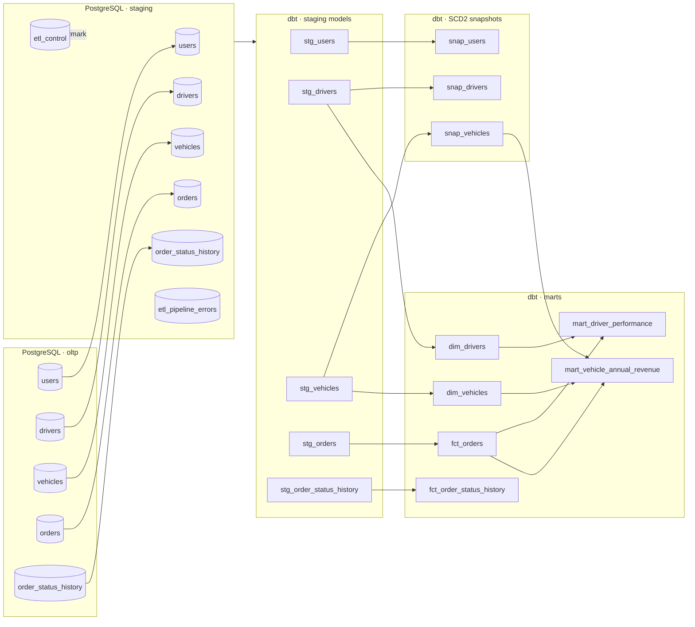

# Transfers DWH

Учебный Data Engineering-проект: аналитическое хранилище данных для сервиса трансферных перевозок.

Проект демонстрирует полный локальный pipeline:

**OLTP → Staging → dbt → DWH → Data Marts**,
с инкрементальной загрузкой, watermark-контролем, SCD2, тестированием данных и оркестрацией через Apache Airflow.

---

## Architecture



### Airflow DAG

Полный pipeline выполняется в следующем порядке:

```text
load_to_staging
        ↓
dbt_run_staging
        ↓
dbt_snapshot
        ↓
dbt_run_marts
        ↓
dbt_test
```

Это важно, потому что snapshots используют модели `stg_*`, поэтому staging-модели должны существовать до запуска `dbt snapshot`.

---

## What the project demonstrates

### Incremental ETL

Данные из `oltp` загружаются в `staging` PL/pgSQL-процедурами.

Загрузка выполняется инкрементально по `updated_at`, а состояние загрузки хранится в:

```text
staging.etl_control
```

Для каждой таблицы используется собственный watermark.

### ETL error logging

Ошибки ETL записываются в:

```text
staging.etl_pipeline_errors
```

Это позволяет отдельно контролировать состояние загрузки.

### OLTP audit

На уровне OLTP используются PostgreSQL triggers/functions.

Изменения статусов заказов фиксируются в:

```text
oltp.order_status_history
```

Также автоматизируется создание/изменение записей водителей при изменении роли пользователя.

### SCD Type 2

Для следующих сущностей используются dbt snapshots:

```text
snap_users
snap_drivers
snap_vehicles
```

Это позволяет хранить историю изменений сущностей.

Например, `mart_vehicle_annual_revenue` может использовать состояние автомобиля, актуальное на момент выполнения поездки, а не только его текущее состояние.

### Incremental dbt models

Фактовые модели:

```text
fct_orders
fct_order_status_history
```

строятся инкрементально.

### Data quality

В dbt используются проверки:

* `unique`
* `not_null`
* `relationships`
* `accepted_values`

---

## Tech Stack

| Technology              | Purpose                   |
| ----------------------- | ------------------------- |
| PostgreSQL 13           | OLTP, staging и DWH       |
| Apache Airflow 2.7.3    | orchestration             |
| dbt-core / dbt-postgres | transformations           |
| Python 3.11             | test data generator       |
| Faker                   | synthetic data generation |
| Docker Compose          | local infrastructure      |
| Redis                   | Airflow Celery broker     |

---

## Repository Structure

```text
.
├── dags/
│   └── transfer_pipeline.py
│
├── docker/
│   ├── generator/
│   │   ├── Dockerfile
│   │   └── requirements.txt
│   │
│   └── postgres/
│       └── init/
│           ├── 00_create_databases.sql
│           └── 01_init_transfer_system.sh
│
├── sql/
│   ├── 01_oltp_schema.sql
│   └── 02_staging_schema.sql
│
├── transfers_dwh/
│   ├── models/
│   │   ├── stg/
│   │   └── marts/
│   ├── snapshots/
│   ├── dbt_project.yml
│   ├── profiles.yml
│   └── generate_data.py
│
├── docker-compose.yaml
├── .env.example
└── README.md
```

---

# Quick Start

## Prerequisites

Нужно установить:

* Git
* Docker Desktop
* Docker Compose v2

Локальный PostgreSQL и Python устанавливать не требуется: PostgreSQL, Airflow и генератор данных запускаются в Docker-контейнерах.

Для Airflow желательно выделить Docker Desktop не менее 4 GB RAM.

---

## 1. Clone repository

```bash
git clone https://github.com/artemlizun5-maker/transfer_system_dwh_pipeline.git
cd transfer_system_dwh_pipeline
```

---

## 2. Start PostgreSQL

Сначала запускаем только PostgreSQL:

```bash
docker compose up -d postgres
```

Проверяем состояние:

```bash
docker compose ps
```

PostgreSQL должен перейти в статус `healthy`.

При первом запуске init-скрипты автоматически:

* создают database `transfer_system`;
* создают schema `oltp`;
* создают schema `staging`;
* создают таблицы;
* создают functions/triggers;
* создают staging ETL procedures.

---

## 3. Generate test data

Проект содержит отдельный Docker service для генерации тестовых данных.

Запусти:

```bash
docker compose --profile bootstrap run --rm data-generator
```

Генератор заполнит OLTP тестовыми данными.

В текущем наборе данных создаются:

```text
users                53
drivers              50
vehicles             50
orders               10000
order_status_history ~37580
```

Генератор можно запускать повторно — он очищает OLTP-таблицы и создаёт новый набор данных.

---

## 4. Start Airflow

После генерации данных запускаем весь stack:

```bash
docker compose up -d
```

Проверить контейнеры:

```bash
docker compose ps
```

Должны быть запущены:

```text
postgres
redis
airflow-webserver
airflow-scheduler
airflow-worker
airflow-triggerer
```

---

## 5. Open Airflow

Airflow UI:

```text
http://localhost:8088
```

Default credentials:

```text
login:    airflow
password: airflow
```

---

## 6. Run the DAG

В Airflow открой DAG:

```text
transfers_dwh_pipeline
```

Запусти его вручную.

Pipeline должен пройти:

```text
load_to_staging
        ↓
dbt_run_staging
        ↓
dbt_snapshot
        ↓
dbt_run_marts
        ↓
dbt_test
```

После успешного запуска все задачи должны иметь статус `success`.

---

# Validation

После успешного DAG можно проверить staging:

```bash
docker compose exec postgres psql -U airflow -d transfer_system -c "SELECT 'users' AS table_name, count(*) FROM staging.users UNION ALL SELECT 'drivers', count(*) FROM staging.drivers UNION ALL SELECT 'vehicles', count(*) FROM staging.vehicles UNION ALL SELECT 'orders', count(*) FROM staging.orders UNION ALL SELECT 'order_status_history', count(*) FROM staging.order_status_history;"
```

Ожидаемый результат:

```text
users                  53
drivers                50
vehicles               50
orders             10000
order_status_history   37580
```

Проверить snapshots:

```bash
docker compose exec postgres psql -U airflow -d transfer_system -c "SELECT 'snap_users' AS table_name, count(*) FROM dwh_marts.snap_users UNION ALL SELECT 'snap_drivers', count(*) FROM dwh_marts.snap_drivers UNION ALL SELECT 'snap_vehicles', count(*) FROM dwh_marts.snap_vehicles;"
```

Проверить основные mart/fact tables:

```bash
docker compose exec postgres psql -U airflow -d transfer_system -c "SELECT 'dim_drivers' AS table_name, count(*) FROM dwh_marts.dim_drivers UNION ALL SELECT 'dim_vehicles', count(*) FROM dwh_marts.dim_vehicles UNION ALL SELECT 'fct_orders', count(*) FROM dwh_marts.fct_orders UNION ALL SELECT 'fct_order_status_history', count(*) FROM dwh_marts.fct_order_status_history UNION ALL SELECT 'mart_driver_performance', count(*) FROM dwh_marts.mart_driver_performance UNION ALL SELECT 'mart_vehicle_annual_revenue', count(*) FROM dwh_marts.mart_vehicle_annual_revenue;"
```

Проверить ETL errors:

```bash
docker compose exec postgres psql -U airflow -d transfer_system -c "SELECT count(*) FROM staging.etl_pipeline_errors;"
```

Ожидается:

```text
0
```

Итоговый `dbt_test` должен завершиться без ошибок:

```text
PASS=11
WARN=0
ERROR=0
SKIP=0
TOTAL=11
```

---

# Airflow DAG

DAG:

```text
transfers_dwh_pipeline
```

Основные параметры:

```text
schedule: 0 2 * * *
catchup: false
retries: 1
```

То есть pipeline настроен на ежедневный запуск в 02:00.

Для локального тестирования DAG можно запускать вручную из Airflow UI.

---

# Full Reset

Чтобы полностью пересоздать окружение с нуля:

```bash
docker compose down -v --remove-orphans
docker compose up -d postgres
docker compose --profile bootstrap run --rm data-generator
docker compose up -d
```

После этого снова открой:

```text
http://localhost:8088
```

и запусти DAG.

> `docker compose down -v` удаляет PostgreSQL volume, поэтому все текущие данные будут потеряны.

---

# Useful Commands

Проверить состояние контейнеров:

```bash
docker compose ps
```

Посмотреть логи Airflow scheduler:

```bash
docker compose logs -f airflow-scheduler
```

Посмотреть логи PostgreSQL:

```bash
docker compose logs -f postgres
```

Остановить проект:

```bash
docker compose down
```

Полностью удалить окружение вместе с данными:

```bash
docker compose down -v --remove-orphans
```

---

# Known Limitations

На текущем этапе проекта остаются следующие ограничения:

* нет отдельной проверки синхронизации `is_active` между `users` и `drivers`;
* не запрещена смена водителя у заказа в статусах `assigned` / `in_progress`;
* `dim_routes` и `dim_tariffs` пока не реализованы;
* `mart_vehicle_annual_revenue` использует фиксированный период и требует параметризации;
* проект рассчитан на локальный учебный запуск и не является production deployment.

---

# Project Goal

Основная цель проекта — показать, как можно построить законченный локальный Data Engineering pipeline:

Source OLTP
    ↓
Incremental ETL
    ↓
Staging
    ↓
dbt transformations
    ↓
SCD2 / Incremental models
    ↓
DWH / Data Marts
    ↓
Data Quality Tests

Проект сделан как pet-project для практики PostgreSQL, SQL, PL/pgSQL, dbt, Airflow, Docker и основных подходов Data Engineering.
